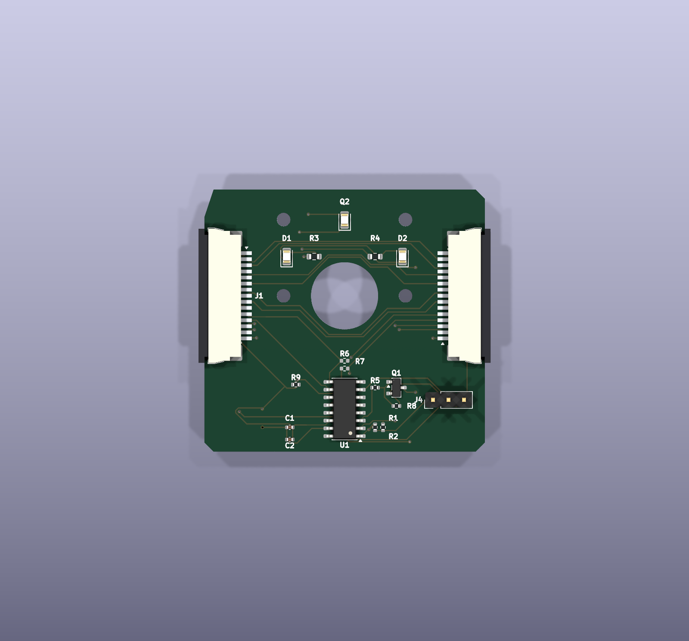
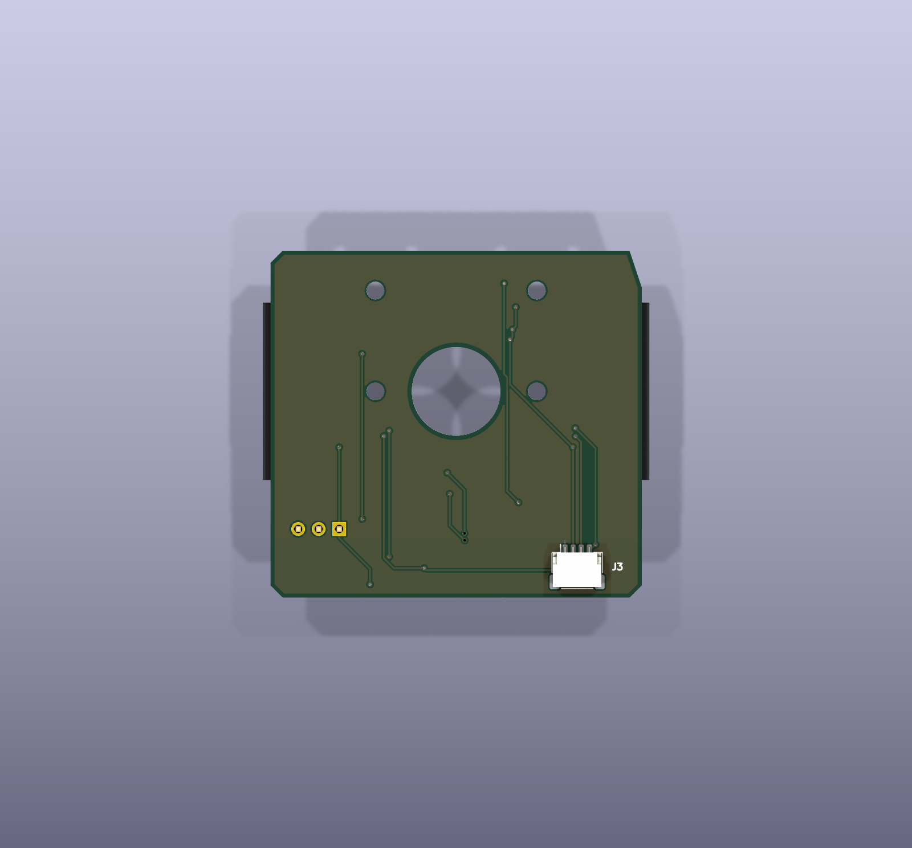
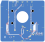
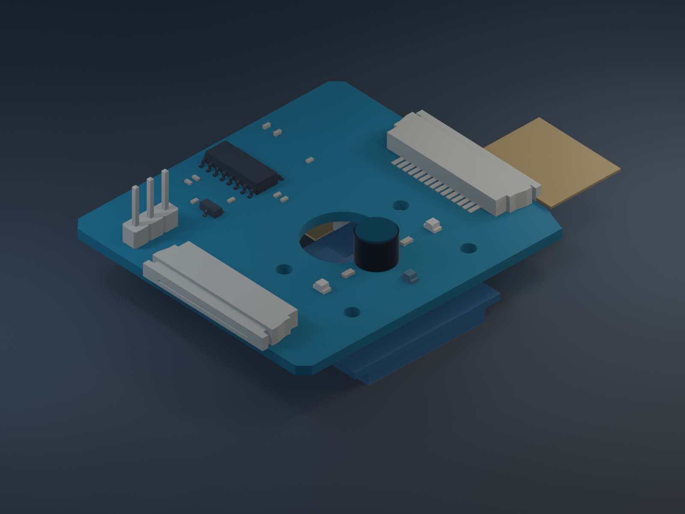
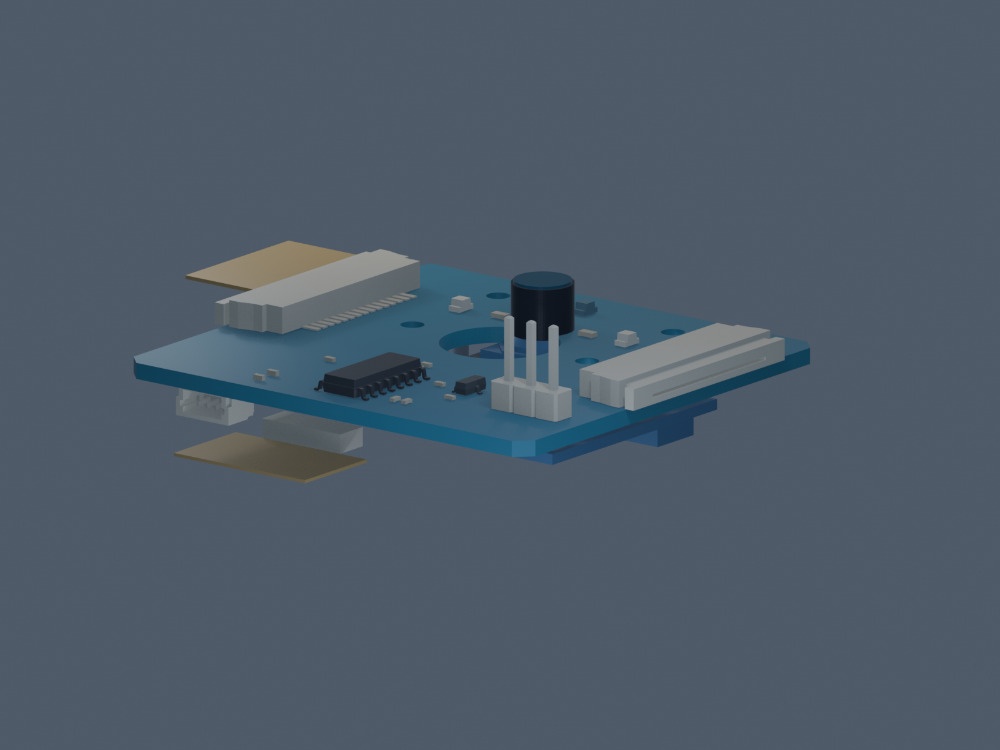
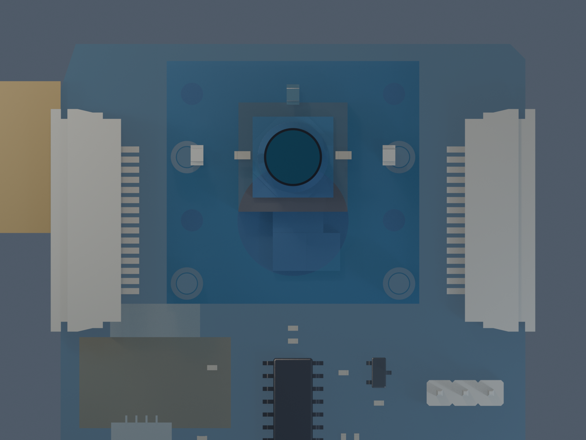
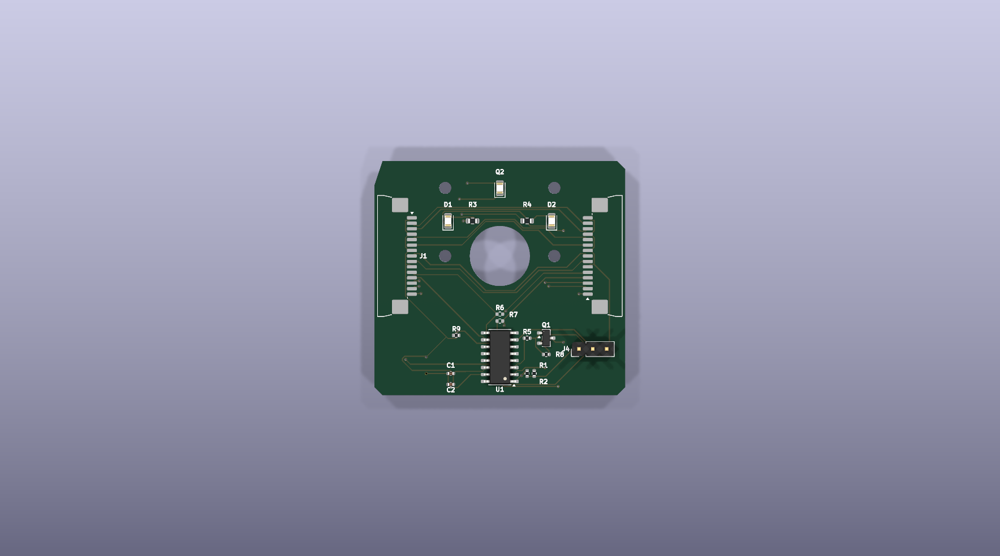
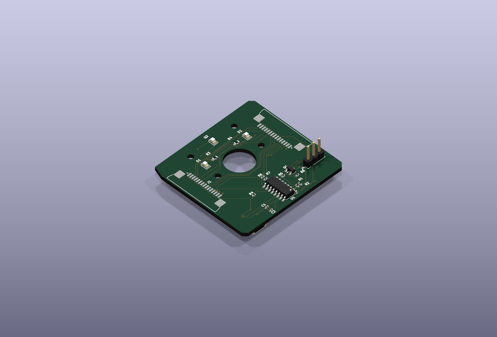

# RPi Camera LED

An interposer for the Raspberry Pi camera flex cable (15 pin, 1.0 mm pitch FPC).
It connects the Pi and camera, passes the camera bus through, and adds a
CH32V003A4M6 for I2C-controlled GPIO 11/12, PWM illumination LEDs, and ambient
light sensing. GPIO 11/12 use 10 kOhm couplers so the MCU can sense Pi-side
levels or drive the camera-side signals.

## Hardware

[KiCad schematic](hardware/rpi-camera-led.kicad_sch) ·
[PDF](hardware/rpi-camera-led.pdf) ·
[board](hardware/rpi-camera-led.kicad_pcb)

### Board: 15-way FFC camera interposer

| 3D render, top | 3D render, bottom | Layout (copper, silk, outline) |
|:--------------:|:-----------------:|:------------------------------:|
|  |  |  |

The routed interposer is 46.0 × 43.0 mm, two layers, with components on both
sides. J1 faces the Raspberry Pi and J2 faces the camera; they are opposite
edge-mounted so the two cable segments leave in line. The 11 mm lens aperture
is centered on the intended camera optical axis, and the illumination LEDs sit
around the aperture on the target-facing side. A fit-check using the supplied
Raspberry Pi Camera v3 3MF model guided the redesign: the 11 mm lens aperture
is aligned to the model's optical axis, and the four interposer holes now
match its 20.0 × 12.5 mm mounting pattern. The model's hole-pattern center is
offset 6.25 mm from the optical axis, so the holes are intentionally
asymmetric about the aperture. The LED row was moved clear of the relocated
mounting holes.

The four 2.2 mm mounting holes follow the supplied Raspberry Pi Camera v3
3MF mesh; see [hardware/cad/README.md](hardware/cad/README.md) for the model
datum and conversion details. The wider outline clears the connectors while
allowing the interposer to mount over the camera; the 6.05 mm-radius two-layer
copper keepout around the lens opening preserves copper-to-aperture edge
clearance. `check_pcb.py` asserts connector alignment and the camera-model
hole coordinates, pitch, and drill.
The 4-pin Qwiic/JST-SH connector (J3) is also edge-facing, with its cable entry
at the lower board edge (J3 at x=17.5 mm, y=53.7 mm, rotated 180°) so the plug
can be inserted without obstructing the camera or its flex. `check_pcb.py`
asserts this edge orientation and the J3 pad map as well as the FFC alignment.

**Routing and design checks pass:** KiCad DRC reports zero violations and
zero unconnected items, schematic ERC is clean, and the netlist matches the
design checker. The three camera differential pairs have these PCB-track
lengths (pads/connectors excluded):

| Pair | P length | N length | Intra-pair mismatch |
|---|---:|---:|---:|
| CSI data 0 | 35.5720 mm | 35.0432 mm | 0.5288 mm |
| CSI data 1 | 35.8428 mm | 35.3092 mm | 0.5336 mm |
| CSI clock | 36.9758 mm | 38.2571 mm | 1.2813 mm |

The data-pair averages are 2.3089 mm and 2.0405 mm shorter than the clock-pair
average. At a rough FR-4 propagation estimate of 6–7 ps/mm, those differences
correspond to about 12–16 ps; this is not a MIPI compliance claim. The actual
stackup/impedance and camera/host timing budget have not been verified.
Confirm the chosen fabricator's stackup and electrical rules before calling
the interposer signal-integrity qualified.

The Gerber/drill, position, sourced BOM and DRC archive is generated by
`uv run hardware/tools/export_manufacturing.py` into
`tmp/manufacturing/manufacturing.zip`. Export is blocked by any DRC errors or
unconnected items. The package is complete for review; verify vendor-specific
rules, current component availability, and the physical camera/FFC fit before
ordering. Production board identity/revision and license/attribution silkscreen
still need to be added and audited.

The camera/interposer stack model and test-render instructions are in
[hardware/cad/README.md](hardware/cad/README.md). The supplied camera model is
included as a faceted STEP converted from its 3MF source; the Raspberry Pi FFC
path remains illustrative.

| Populated interposer | Camera/interposer stackup concept |
|:--------------------:|:---------------------------------:|
|  |  |

The fit-check image shows the routed board with the supplied model's optical
axis and all four mounting holes aligned. This is a model-based fit check, not
physical verification; confirm the camera revision and mounting dimensions
before fabrication.



### How the cables run

| With cables fitted | Isometric |
|:------------------:|:---------:|
|  |  |

Both cables enter from the **outside** edges and run away from the board in
opposite directions, so the interposer drops into an existing cable run in
line. That follows from where the cable entry is on this connector: the
manufacturer's Section A‑A shows the solder tail stepping down and out at one
end while the cable channel opens at the other, and the top view labels
*Terminal* at one end and *Latch* at the other with the 5.30 mm housing
between them. It is also the only way a slide lock can work — you pull the
slider, insert the cable and push it back, all at the same end. So the cable
entry is at the latch end, away from the pads, and with each connector's
housing flush against its board edge that entry points outward.

The two cable stubs are drawn different ways up, and that is the point. J1 is
bottom contact, so its cable presents bared copper *downwards* and shows you
the blue backing; J2 is top contact, so its cable is the other way up and
shows you the conductors. That flip is the whole reason for pairing an F part
with an E part, and it is what lets both segments be ordinary Raspberry Pi
camera cables — the same flip you can see in a real cable, blue stiffener on
one face at one end, bared conductors on the other face at the other.

The stubs are illustrative and are not part of the board: they exist only in a
throwaway copy that the render script builds and deletes. Their 16.00 × 0.30 mm
section is the drawing's recommended FFC dimension. The bared conductors and
the backing are drawn a little longer than the 4 mm insertion depth so that a
few millimetres of each stay visible outside the connector — otherwise the
orientation they exist to show would be buried inside it.

Regenerate the images with `uv run hardware/tools/render_board.py`, and the
connector models with `uv run hardware/tools/gen_connector_model.py`. The
render script refills the copper zones first, via the pcbnew Python module
inside the KiCad snap, because `kicad-cli` has no zone-fill command and a
stale pour renders as authoritatively as a fresh one — when this was first
wired up the stored B.Cu pour was less than half its true area, and refilling
it dropped DRC from 116 violations to 17.

### Connectors, and which cables fit

J1 and J2 are **not** the same part, and that is deliberate:

| | part | contacts | mates with |
|---|---|---|---|
| **J1** → Raspberry Pi | JUSHUO AFA07-S15**F**CA-00 (LCSC C262721) | **bottom** — cable copper faces the board | a standard Pi camera cable |
| **J2** → camera | JUSHUO AFA07-S15**E**CA-00 (LCSC C262742) | **top** — cable copper faces away | a standard Pi camera cable |

The reason is cable parity. A Raspberry Pi camera cable is an *opposite-side*
FFC — "type 2", contacts on one face at one end and the other face at the other
— because the Pi's CSI socket is top-contact and the camera module's is
bottom-contact. Cutting one continuous cable anywhere yields one same-side half
and one opposite-side half, so an interposer whose two connectors want the
copper on the *same* face forces one odd, hard-to-buy cable. One that wants it
on *opposite* faces absorbs the asymmetry, and both segments become ordinary
Raspberry Pi camera cables. Bottom-contact at J1 plus top-contact at J2 is that
pairing.

The two variants share one land pattern — verified against both JUSHUO drawings
— so nothing on the board moves between them. Since only the contact side
differs, and it is invisible on an assembled board, the distinction is called
out in each symbol's value, in the MPN, and as a `BOTTOM CONTACT` / `TOP
CONTACT` marker on the fab layer.

Both footprints and their 3D models live in this repository, in
`hardware/rpi-camera-led.pretty` and `hardware/rpi-camera-led.3dshapes`. KiCad's
stock footprint references a STEP file for the JUSHUO AFA07 series that does not
exist — not in the KiCad distribution and not in `kicad-packages3D` upstream,
which ships no JUSHUO models at all. Third-party libraries have one, but under
terms that forbid redistribution, so `hardware/tools/gen_connector_model.py`
builds it from the manufacturer's published drawing instead: a 22.00 × 6.95 ×
2.50 mm envelope matching the drawing's DIM D, the F.Fab outline and the side
view's height, with the housing and latch coloured as the drawing's notes
specify. Both STEP and WRL are generated, the latter in the 0.1-inch units
KiCad expects.

The direct pass-through signals are wired J1 pin *k* ↔ J2 pin *16−k*. That
looks reversed but is exactly right: the two connectors are 180° apart, so J1
pad *k* physically faces J2 pad *16−k*. Camera GPIO 11/12 are the exception:
their Pi-side and camera-side nets are coupled through R6/R7 (10 kOhm) so U1
can sense the Pi and override the camera-side level. `check_pcb.py` measures
connector alignment as a number, because losing it to a stray drag puts a
dogleg in the direct pass-through nets and is invisible by eye.

### Verifying

```
uv run hardware/tools/check_schematic.py   # ERC + netlist vs design intent
uv run hardware/tools/check_pcb.py         # connector alignment + DRC parity
```

`check_schematic.py` checks ERC and expected connectivity. The final design
uses the CH32V003A4M6 SOP-16 pin map; firmware build verification is documented
in [firmware/README.md](firmware/README.md). Hardware bring-up has not yet
been performed.

## Firmware

[CH32V003 firmware](firmware/README.md): a fail-safe I2C bootloader plus an
application exposing camera GPIO control, RPi-side GPIO readback, GPIO
pass-through, LED brightness (hardware PWM) and an ambient light reading over
a Linux-friendly SMBus register map at address 0x42. Builds with
`riscv64-unknown-elf-gcc` and [ch32v003fun](https://github.com/cnlohr/ch32v003fun)
(`git submodule update --init`, then `make` in `firmware/bootloader` and
`firmware/app`).

The firmware pin map matches the current schematic and both bootloader and
application build with the documented open-source RISC-V toolchain. The
firmware has not been flashed or tested on physical hardware.

## Research

Part availability research comparing [JLCPCB's PCBA parts
library](https://jlcpcb.com/parts) and [NextPCB's Rev0
service](https://www.nextpcb.com/rev0-pcba) (which sources components from [HQ
Online](https://www.hqonline.com/)'s 600k+ in-stock inventory):

* [I2C controllable RGB LEDs](research/i2c-rgb-leds.md)
* [I2C GPIO expanders with LED driving capability](research/i2c-gpio-expanders.md)
* [Cheap (< $0.50) MCUs with I2C and no external parts required](research/cheap-mcus.md)
* [RPi camera compatible FPC connectors (1.0 mm pitch, 15 pin)](research/fpc-connectors.md)

## License

Apache 2.0 — see [LICENSE](LICENSE).

## Manufacturing outputs

Run `uv run hardware/tools/export_manufacturing.py` to write Gerbers, drill
files, positions, sourced/JLCPCB BOMs and `manufacturing.zip` into
`tmp/manufacturing/`. It checks DRC before export and reports parts missing an
LCSC number; the current design passes DRC and the BOM has no missing LCSC
codes. `--allow-incomplete` permits a review-only export and labels it
`NOT_FOR_FABRICATION.txt`—never send that package to a board house.
`kicad-cli` is found automatically; set `KICAD_CLI` to override. See issue #1
for the remaining production qualification work.
